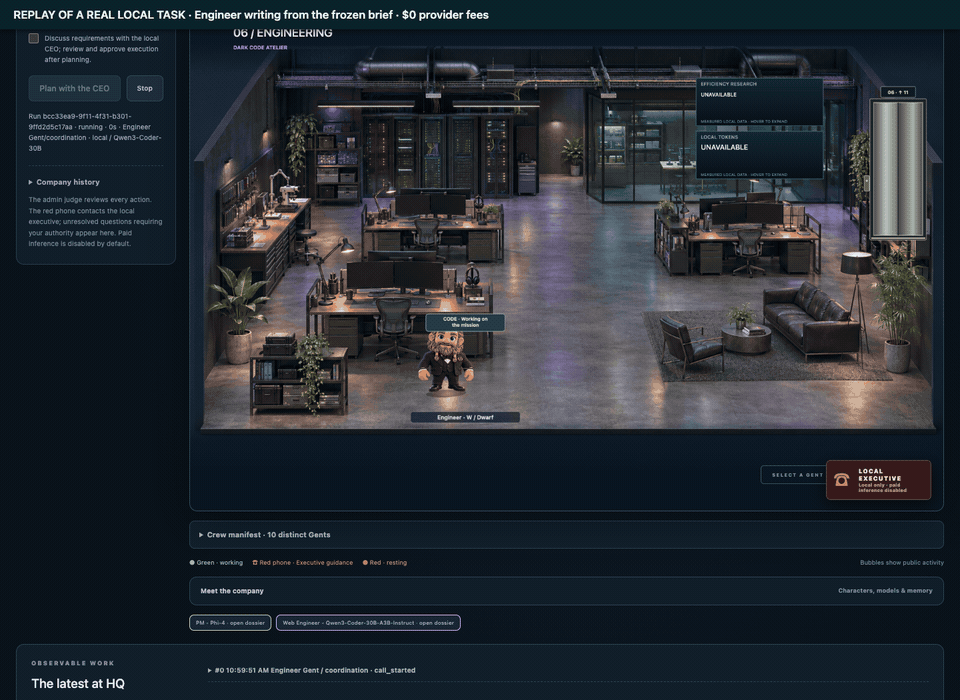

# Gents Office

[](docs/123-website-support-and-deployment.md) [](docs/versions/0.1.0.md) [](https://github.com/Monzingo89/gents-rust-lab/actions/workflows/ci.yml) [](https://github.com/Monzingo89/gents-rust-lab/actions/workflows/dependency-advisories.yml) [](LICENSE)

A free local company of AI agents. Discuss an outcome with the CEO, review the work and permissions, and inspect recorded steps and independent checks. Original project code is [MIT licensed](LICENSE). Models and [third-party material](THIRD_PARTY_NOTICES.md) retain their own terms.

**Status: local development preview · 0.1.0.** The guided conversation-to-factory path and separate local final review are implemented for bounded reasoning tasks. Bounded local tasks have actual verification evidence; arbitrary-task completion, industry compliance and production readiness are not established.



*Labeled replay of a real completed local writing task: 231 seconds, 3,326 local tokens, $0 provider fees. Earlier native CEO planning was retained; no new model runs occur during replay. [Transcript, independent verification and failed trials](docs/128-independent-reasoning-acceptance.md).*

## Why run a local company?

- Keep inference on your own computer using reviewed local models.
- Target **$0 provider and tool fees** for supported local tasks. Local tokens, hardware, electricity and frontier development are separate costs.
- Give each actor only its assigned tools, communication peers and memory access.
- Inspect native receipts, failures, checkpoints and acceptance checks instead of relying on confident prose.
- Replace architecture, worker, access and storage adapters through explicit ports rather than rewriting the company.

## Start here

Visit **[metivolve.com](https://metivolve.com)** for the first-task guide, computer-check handoff, calculators, FAQ and [support](https://metivolve.com/support). It is an evaluation preview. The source is public; your running company, models and task data stay on your computer. Explore the [MCP cookbook](https://metivolve.com/cookbook) and [contribution guide](CONTRIBUTING.md).

To preview the website on your computer:

```sh
npm run site:preview
```

Keep that terminal running and open **http://127.0.0.1:4173**. This static local preview needs Node.js and Python 3. It does not run models, send task text, collect analytics or expose the private company. Stop it with Ctrl+C. The hosted evaluation site remains unindexed pending the owner trial and release review. Only the hosted support form can submit a message; the static local preview has no mail backend.

To run the **local company**, first follow the [setup and model requirements](docs/18-admin-company-and-operations.md) and [local first-run guide](docs/15-local-company-first-run.md). You need the documented toolchain, compatible inference runtime, owner-reviewed configuration and separately installed model weights; models are not included in Git. Initial dependency/model acquisition may require a network. Then, from the repository root:

```sh
npm run company
```

Run `npm run env:check` to audit private settings without revealing credential values. Local inference needs **no API key**. See [environment files and architecture review](docs/122-local-environment-and-architecture-review.md).

Keep its terminal open. The launcher opens the local office and checks readiness. Describe one bounded outcome, answer the CEO's questions, and review the exact definition of done and permissions before starting. Missing models or unsupported tools are errors, not permission to substitute a simulation or paid provider. The ready-plan panel can now request a local CEO recommendation and a distinct local judge review, with fresh hardware checks and a proposed agent count. Use the ready-plan Prepare button for the guided factory path. Review data scope, the exact local reviewer, tools and memory ceilings before approving. Older/manual execution paths have separate contracts; tool-enabled hub/peer execution remains unavailable.

For same-Wi-Fi mobile access, see [the separate pairing guide](docs/19-mobile-access.md). Keep the execution daemon private; publishing the introduction site does not publish the company.

## What is verified?

| Area | Evidence | Practical limit |
| --- | --- | --- |
| Owned local workflow | Six selected native calls, four typed dependencies and two independently checked output files; local CEO/QA replies and $0 provider/tool fees. [Recorded result](docs/114-type-directed-local-selection.md) | One frozen synthetic case; no arbitrary-task claim. |
| Reasoning patterns | Distinct flow, hub delegation and peer revision, with actual local model probes. [Coordination programs](docs/116-local-coordination-engine.md) | New guided intakes include separate local final review. Strict JSON task trials failed; broader hub/peer task capability remains unqualified. |
| Factory preparation | Repository-backed roles/architecture/control composition and a frozen reasoning program through normal intake/approval/governance. [Preparation guide](docs/118-factory-reasoning-preparation.md) | Guided CEO/judge selection now prepares the normal frozen review. [Real writing task](docs/128-independent-reasoning-acceptance.md); general tool-enabled hub/peer effects and wider qualification remain open. |
| Owned MCP | Separate Rust module, shared native catalog and stdio/loopback HTTP/SSE adapters. [MCP guide](mcp/README.md) | Tool/platform support is explicit; legacy Python tools are not all migrated. |
| Memory | Per-agent staging, source lineage, policy epochs and checked local archive records. [Memory checkpoints](docs/67-local-memory-archive-checkpoints.md) | Integrity is not factual truth, recall quality or fine-tuning. |
| Platform | Local model fitting/capacity management and a verified macOS code sandbox. | Some file tools support Linux; generated-code isolation currently fails closed outside its supported macOS path. |

The recorded six-call observation took 188 seconds and 37,027 local tokens. It is one checkout/workload observation, not a prediction for another GPU. The site calculator uses **your measured** input/generation speeds; M4, M5 and PC labels do not invent throughput or model fit.

## From request to checked result

1. **Clarify:** supply inputs, desired output, exclusions and exact checks that mean done. The local CEO asks when requirements are missing.
2. **Compose:** inspect architecture, configured roles, owned tools, communication ceilings and unresolved control requirements. A preview cannot grant access.
3. **Approve:** freeze the intake and approve its exact digest. Install owner-selected permissions within the task ceilings.
4. **Execute:** use only admitted local models/tools. Preserve receipts and unresolved actions; never blindly replay an uncertain write or model call.
5. **Verify:** inspect independent acceptance evidence. Peer agreement, valid citations and an agent saying “100%” do not complete the task.

The implementation references the publisher's public [chapter 4 preview of *AI Agents in Action, Second Edition*](https://www.manning.com/preview/ai-agents-in-action-second-edition/chapter-4) for flow, orchestration and collaboration vocabulary. It does not claim full-book access, endorsement or compliance certification.

## Architecture and recipes

- [Verified monorepo ownership, workspace boundaries and container source inputs](docs/174-monorepo-architecture.md)
- [Metivolve first-task journey and hardware-check boundaries](docs/125-metivolve-onboarding.md)
- [Instant setup answers and public-request limits](docs/126-fast-answers-and-abuse-limits.md)
- [Local image generation, speech and automatic output routing](mcp/media/README.md)
- [Actual local CEO conversation and measured planning comparison](docs/124-local-ceo-reasoning-conversation.md)
- [Local environment files, hardware and two-model architecture review](docs/122-local-environment-and-architecture-review.md)
- [Website, support and deployment operations](docs/123-website-support-and-deployment.md)
- [Factory contracts and initial release review](docs/113-factory-and-local-release-review.md)
- [Independent local final review, real task and known limits](docs/128-independent-reasoning-acceptance.md)
- [Bounded local Python repair-to-review submission and failed trials](docs/140-bounded-python-review-submission.md)
- [Real observer repair, source-page preservation and read-only run observation](docs/141-observer-repair-and-python-followups.md)
- [Durable budget stops and one-call source-authoring trials](docs/142-budget-stops-and-typed-test-authoring.md)
- [Governed file renames, binary fingerprints and uncertainty handling](docs/143-governed-file-renames.md)
- [Evidence-triggered experiment queue and rejected decomposition trial](docs/144-evidence-triggered-experiments.md)
- [Independent Rust experiment results and zero-inference candidate checks](docs/145-independent-experiment-results.md)
- [Conditional follow-up trials, verified feedback delivery and unchanged-source stops](docs/146-conditional-experiment-continuation.md)
- [Focused source context, measured failures and reviewed Rust/Python repairs](docs/147-focused-author-context-and-reviewed-repairs.md)
- [Active CEO/cache-first architecture refactor: implemented path and full remaining scope](docs/148-ceo-cache-first-architecture.md)
- [CEO-to-factory handoff and current execution limits](docs/127-guided-factory-handoff.md)
- [Read-only factory preview](docs/115-company-factory-preview.md) and [reasoning preparation](docs/118-factory-reasoning-preparation.md)
- [All 16 owned native MCP recipes and exact schemas](docs/121-owned-mcp-cookbook.md)
- [Owned MCP transports, native tools and governance](mcp/README.md)
- [MCP basement and local CEO workflow](docs/39-mcp-basement-and-local-ceo.md)
- [Training evaluation, reviewed promotion and oversight](docs/16-training-room-and-ceo.md)
- [Task evidence and the separate fictional audit workflow](docs/17-task-evidence-and-audit.md)
- [Security defaults and reporting](SECURITY.md)

The native cookbook covers the current registry; legacy broker tools are a separate path. The labeled real-task replay is available. The broader capability benchmark and release asset/dependency review remain in progress. Use exact tool descriptors and current grants; the building's rooms visualize permissions, while native policy enforces them.

## Check changes locally

For the bounded offline execution baseline and architecture map, see [local execution checks and backlog](docs/162-local-execution-baseline.md). Run `python3 scripts/local_evaluate.py` to build current binaries and check caching, workflows, native MCP lifecycle and building screens with explicit mock workers. This writes private measurement/log evidence without loading models or using paid inference. Repository development skills are canonical in `.agents/skills`; run `node scripts/repo-skills.mjs` to check discovery links.

With the documented dependencies already installed:

```sh
bash scripts/check.sh
```

This runs offline-capable Rust, Node, Python, protocol and build checks. Actual model probes are explicitly opt-in and consume local inference tokens. To check only the introduction site:

```sh
npm run test:site
```

For its browser smoke, keep `npm run site:preview` running in another terminal, then run `npm run test:site:browser` with the already-installed Playwright Chromium. No browser/model download is performed by that smoke.

## Release boundaries

There is no SOC attestation or blanket HIPAA, banking, fintech or health compliance claim. Policy pages are drafts; controls require operator evidence and independent assessment. Unknown usage/cost remains unknown, and model output remains advisory. Review model provenance and security findings before admission.

The public website is an introduction and cookbook, separate from the private local execution service. Model weights, datasets, adapters, credentials and runtime records are excluded from Git and deployment. Install and review models locally; no model weights ship with this source release. See [release operations](docs/132-public-source-release.md), [changelog](CHANGELOG.md), and [measured model capabilities](docs/131-model-capability-scorecard.md).

Older mock/desktop/cloud teaching material is preserved in [the historical onboarding snapshot](docs/119-historical-readme.md) and [numbered walkthrough](docs/00-start-here.md). Mock responses demonstrate lifecycle only; they do not solve a task. Advanced provider adapters do not change the default local-only company boundary.
