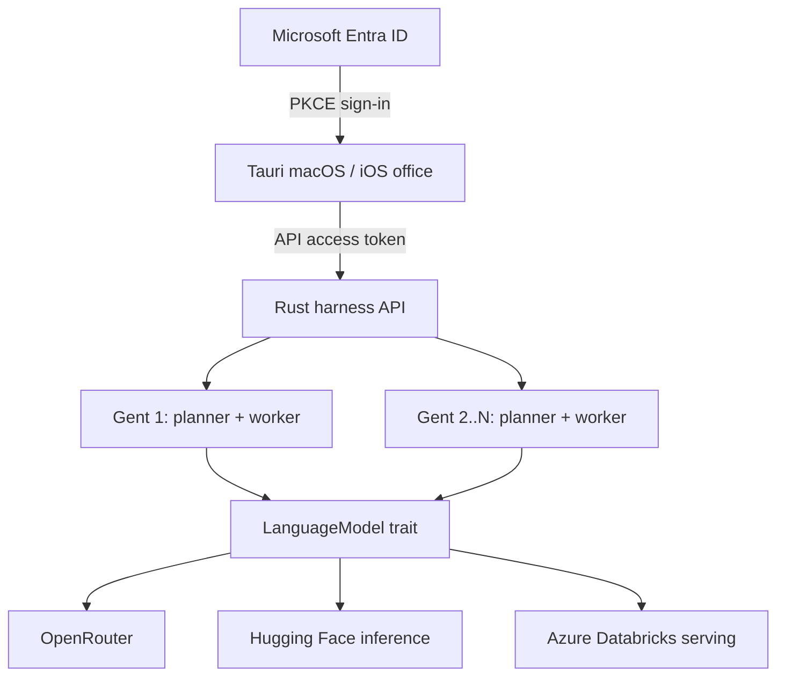

# 00 — The project you will build

Your goal is a native Gents Office app backed by a model-agnostic Rust harness. You enter a task, watch planner and worker sprites move between rooms, inspect their public outputs, and measure calls. Azure handles identity and hosts the backend. OpenRouter, Hugging Face, and Databricks are independently selectable sources of inference.

**Terminology correction:** an agent contains a planner model slot and a worker model slot. A model is the inference engine used in a slot. A single underlying model can fill several slots; each call still has its own context. Two agents mean four model slots, not necessarily four distinct model downloads or hosted deployments.

## The architecture

The harness solves a concrete problem: LLM APIs generate responses but do not, by themselves, own your task lifecycle, validate plans, choose agents, retain run state, enforce authorization, stop loops, or emit an office event stream. Those responsibilities live in `main.rs`. The `LanguageModel` trait keeps the lifecycle independent of a particular provider SDK.

A planner is an LLM call instructed to create a small typed plan. A worker is another LLM call instructed to perform a plan step. This starter supports text tasks using supplied evidence. It cannot browse, read arbitrary files, invoke Databricks tools, or execute generated code. Inference through Databricks is separate from Databricks data retrieval.

## A task from start to finish

1. You enter a task and consent to the selected providers receiving it.
2. The API authenticates the caller, checks task length and reserves a run.
3. Claude Atlas's planner returns a JSON plan.
4. Rust validates the plan; malformed or oversized plans fail visibly.
5. Atlas's worker performs each step. Each step receives its previous draft.
6. Atlas's final output is handed to Vera Veo.
7. Vera plans and works on her review assignment.
8. The harness reports success, failure, or cancellation and emits the final output.
9. The UI polls the run snapshot and animates planner/worker sprites accordingly.

Agents execute sequentially to make handoffs easy to follow. Changing to parallel scheduling requires a dependency graph and a concurrency limit; it is not just spawning N tasks against shared mutable state.

## What you can observe

- The planner's declared plan and brief action summary.
- Worker outputs, completed-call events and latency.
- Model/provider identity and reported usage per call.
- An outlined waiting sprite during a call; movement after state transitions.
- Failure and cancellation states.

Private internal chain-of-thought is not an available universal feature. Do not label a generated explanation as a transcript of the model's internal thinking. Provider-reported reasoning token counts describe usage, not necessarily visible text. No hidden reasoning is requested, stored, or displayed in this starter.

## Scope and cost

“Every Azure resource” is not a useful deployable requirement: Azure includes unrelated, overlapping products, costly infrastructure, and region-specific offerings. Chapter 08 gives a broad service map and recommends which components to add and why. Provision the smallest stage that teaches the next concept. Azure budgets are alerts, not guaranteed spend caps.

The first run has no cloud cost. Live inference, Databricks serving, registries, telemetry and other cloud resources can incur charges. The sample caps agent count, steps and output tokens; it does not enforce a guaranteed dollar cap.

Follow chapters 01 through 13, including the optional 01a hand-coding route. Chapter 12 describes the upgraded default judge-driven lifecycle; the original fixed lifecycle above is available as `config/fixed.mock.json`. A checkpoint at the end of each chapter tells you what should work before moving on.

## Updated default lifecycle

The default now routes through a model-selection judge before agents run and an independent completion judge afterward. A rejected candidate returns, with feedback, to the routing judge for another bounded round. Acceptance criteria remain fixed. Read chapter 12 before interpreting completion in the default demo.

The final version now checkpoints events to local SQLite, recovers interrupted history without replaying requests, and adds optional deterministic acceptance vetoes. Chapter 13 documents the journal, deadlines, idempotency, recovery UI and production boundaries.
