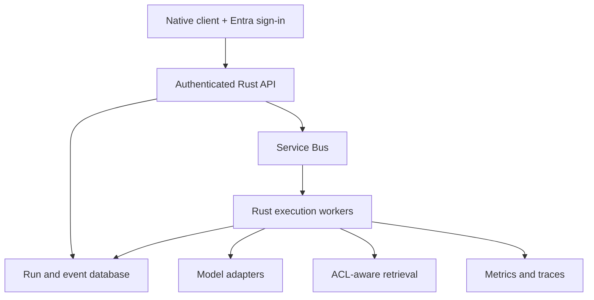

# 08 — Azure service map and staged architecture

This is a purposeful map of relevant Azure services, not an instruction to deploy the entire Azure catalog. Several rows are alternatives. Provisioning all of them would add duplicated systems and cost without improving the harness.

| Concern | Azure resource / service | Stage and purpose |
|---|---|---|
| Subscription organization | Management groups, subscriptions, resource groups | Separate personal lab from enterprise environments |
| Identity | Microsoft Entra ID app registrations | Chapter 05 user authentication and delegated API access |
| Workload credentials | Managed Identity, Azure RBAC | Chapter 06 app-to-vault and app-to-registry access |
| Secret storage | Key Vault | Chapter 06 provider credentials; rotate without app rebuild |
| API hosting | Container Apps | Chapter 06 managed Rust container; single instance initially |
| Image storage | Container Registry | Chapter 06 immutable deployment images |
| Logs | Azure Monitor, Log Analytics | Chapter 06 platform logs; later structured telemetry |
| Application tracing | Application Insights / OpenTelemetry | Exercise: run/agent/call spans and usage metrics |
| Model/data platform | Azure Databricks + Unity Catalog + MLflow | Chapter 04 governed model artifacts, serving and later retrieval |
| Model inference alternative | Azure AI / Foundry model endpoints, Azure OpenAI | Optional additional provider adapter; verify endpoint API shape and auth |
| Training alternative | Azure Machine Learning | Use when custom ML jobs need its lifecycle rather than Databricks; do not duplicate by default |
| Raw evidence and artifacts | Storage account, Blob Storage / ADLS Gen2 | Exercise: source documents, generated artifacts, model data with lifecycle retention |
| Structured state | Azure Database for PostgreSQL | Recommended relational run/call/event store exercise |
| Distributed state alternative | Cosmos DB | Alternative to PostgreSQL if access pattern and scale justify it |
| Semantic retrieval | Azure AI Search | Alternative to Databricks Vector Search; choose one initial index |
| Async work | Service Bus | Durable run dispatch, dead-letter handling and consumer ownership |
| Data/event triggers | Event Grid | Optional storage-created events that enqueue authorized work |
| Timed tasks | Functions / scheduled Container Apps Jobs | Optional scheduled ingestion and evaluation |
| API gateway | API Management | Later quotas, API versioning and policies; Rust still validates access |
| Global web edge | Front Door + WAF | Later public entry point if geography/abuse traffic requires it |
| Custom domain | Azure DNS and certificates | Stable production HTTPS API address |
| Private network | Virtual Network, subnets, NSGs | Private routing for backend/data services |
| Private service access | Private Endpoints + Private DNS | Restrict vault/storage/database after DNS and egress are tested |
| Outbound control | NAT Gateway / Azure Firewall | Optional egress controls and allowlisting for external inference |
| Enterprise posture | Defender for Cloud, Azure Policy | Guardrails and posture management in larger deployments |
| Billing governance | Cost Management, budgets, tags | Track dev spend; alerts are not automatic spend caps |
| CI/CD | GitHub Actions with Entra workload identity federation, or Azure DevOps | Build/test/deploy backend without long-lived Azure deployment secrets |
| Container orchestration alternative | AKS | Only if Container Apps cannot meet actual scheduling/network needs |
| VM alternative | Virtual Machines / GPU compute | Only for workloads needing dedicated hardware; not required for hosted APIs |
| Infrastructure source | Bicep + Azure Resource Manager | Version and review cloud changes |

## The production direction

The final starter uses a local SQLite journal and an in-process worker; the shared database/queue boxes remain a later distributed architecture. This drawing shows a later architecture, not the deployed contents of `main.bicep`.

## Suggested learning order

- **Local:** Rust, mock models, event-driven GUI; no cloud resources.
- **Inference:** OpenRouter and HF, then Databricks serving.
- **Identity:** two Entra app registrations, delegated API scope and owner checks.
- **Hosted lab:** Container Apps, ACR, identity, vault and logging.
- **Reliability:** persistent database, queue, restart recovery and telemetry.
- **Knowledge:** Blob/ADLS plus one ACL-aware retrieval system.
- **Enterprise:** private networking, policy, gateway, WAF and CI/CD when justified.
- **Model lifecycle:** versioned evaluation, optional training and deployment promotion.

For each new resource, write a one-sentence answer to: “What observed problem does this service solve?” If you cannot answer, defer it. Do not create redundant Azure AI Search and Databricks Vector Search indexes solely to use more services.
