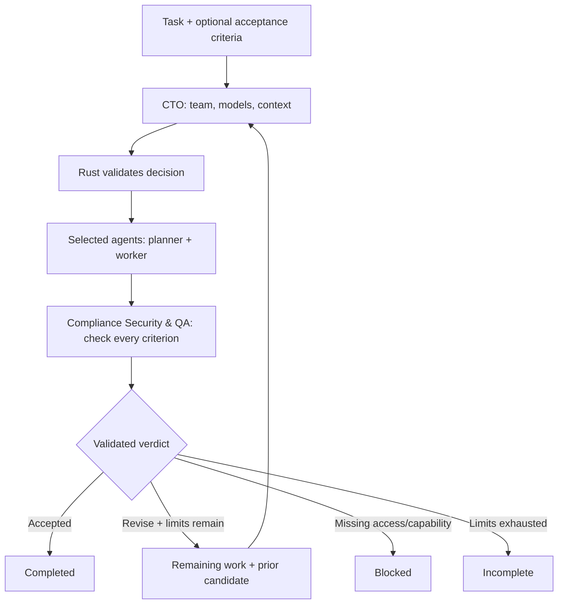

# 12 — AI routing, definition of done and repair loops

This upgrade adds two independent model roles to the harness: a **CTO** for routing and a **Compliance Security & QA Engineer** for final assurance. Both can use different providers/models. Their public decisions, outputs, latency and reported usage appear in the office alongside the agent calls.

## 1. The new lifecycle



Malformed decisions and provider failures terminate as `failed`; cancellation terminates as `cancelled`. Only a validated `accepted` verdict AND passing optional deterministic acceptance checks produce `completed` in judge mode (chapter 13). The harness never treats a worker saying “done” as the completion signal.

This is an AI evaluation loop, not a guarantee of correctness. A judge can make mistakes. For tasks with deterministic acceptance tests, implement those checks and require them alongside the AI verdict. The current harness still performs text work from supplied evidence only.

## 2. Run the upgraded demonstration

From the project root:

```bash
cargo run -p gents-harness --locked
```

Open the office, click Connect and Start task. The default `config/mock.json` now enables judge mode:

1. The CTO proposes two acceptance criteria (unless you supplied your own) and deploys Atlas and Vera.
2. Each agent makes one planner call and two worker calls.
3. The Compliance Security & QA Engineer deliberately returns a **simulated revise** verdict.
4. The CTO deploys Vera alone for repair, changes the model-slot selection, and passes `previous_round` plus `feedback`.
5. Vera plans and performs two worker steps.
6. Compliance Security & QA returns **simulated accepted**; the run becomes completed.

This is 13 completed model calls: four judge calls plus nine agent calls. Mock tokens remain unknown and mock provider cost is zero. Mock acceptance is a scripted lifecycle demonstration, not an assessment of the answer's quality. The office now has routing (R) and completion-judge (J) sprites. Agent cards display the chosen model catalog IDs, context sources and whether the agent is deployed in the current round.

To retain the earlier fixed two-agent exercise:

```bash
CONFIG=config/fixed.mock.json cargo run -p gents-harness --locked
```

Fixed mode has no judges or repair loop and completes after six mock calls. Remove the entire `judges` field to select fixed mode in other configurations.

## 3. Configure the model catalog

Open `config/mock.json` or copy `config/live.example.json` to `config/local.json`. The new `judges` object contains:

| Setting | Meaning |
|---|---|
| `router` | Model configuration for the CTO routing role |
| `completion` | Model configuration for the independent Compliance Security & QA role |
| `models` | Approved model candidates keyed by stable catalog IDs |
| `max_rounds` | Maximum execution/review rounds, 1..5 |
| `max_calls` | Run-wide cap including BOTH judges, planners and workers, 3..128 |
| `max_context_chars` | Combined instructions + serialized input character limit per call, 16,000..128,000 |

Each candidate has `model` (provider/model/URL/key environment variable), `description` (operator-supplied suitability information), and `allowed_roles` (`planner`, `worker`, or both). Maximum catalog size is 16 in this lab. The roster contains 1..8 available Gents; the CTO selects a unique subset for each round.

In judge mode, the roster's original `planner` and `worker` fields are **fixed-mode defaults only**. Live calls use `judges.models` and the routing decision. The roster's `assignment` describes a Gent's specialty; the router creates the actual round-specific assignment.

The judge selects among configured candidates; it does not download arbitrary models, create serving endpoints, invent URLs or obtain credentials. Set endpoint URLs, credentials and allowed roles yourself. Model descriptions inform selection but are not measured performance benchmarks. Improve them using your evaluation results rather than claiming the judge can always discover an optimal model.

You configure the two judges' own models as a bootstrap decision. They do not recursively select or spawn their own judges. A second role can use a different model/provider for evaluation diversity; it remains an LLM judge rather than a deterministic verifier.

## 4. Definition of done

The UI has an optional Definition of done box, one criterion per line. For the vendor example:

```text
Choose a vendor that supports all four users for at most $40/month.
Use only the supplied prices and user limits.
Explain why the selected vendor qualifies and the alternative does not.
```

The API also accepts it as an array:

```bash
curl -X POST http://127.0.0.1:8787/api/runs \
  -H 'Content-Type: application/json' \
  -d '{"task":"Vendor A is $20 for 2 users; Vendor B is $35 for 5. Choose for 4 users under $40.","consent":false,"definition_of_done":["Support 4 users under $40","Explain the choice using supplied facts"]}'
```

With no supplied criteria, the first routing decision proposes 1..8 criteria derived from the original task. Rust freezes that list. Every later routing decision must copy it exactly; revising or weakening it is an error. If you supply criteria, they are fixed from the beginning. Inspect the first `route_accepted` activity entry to see the frozen definition.

Compliance Security & QA must return exactly one check per criterion, with a zero-based criterion index, pass/fail and nonempty evidence. Rust rejects missing/duplicate checks, acceptance with failed checks, and acceptance that still lists remaining work. `revise` requires at least one failed check and concrete remaining work. `blocked` is available when completion needs unavailable evidence, permissions or capabilities.

Evidence is currently text supplied by the judge. Nonempty text is a schema requirement; Rust does not magically establish that it is true. Add actual task-specific tests for stronger assurance.

## 5. How agents and context are selected

A route contains an ordered array of deployments:

```json
{
  "summary": "Use a drafter followed by an integrating reviewer",
  "definition_of_done": ["Address the task using supplied facts"],
  "deployments": [
    {
      "agent_id": "Claude Atlas",
      "planner_model": "model-1-planner",
      "worker_model": "model-1-worker",
      "assignment": "Create the initial answer",
      "context_from": []
    },
    {
      "agent_id": "Vera Veo",
      "planner_model": "model-2-planner",
      "worker_model": "model-2-worker",
      "assignment": "Review Atlas's answer and integrate the final candidate",
      "context_from": ["Claude Atlas"]
    }
  ]
}
```

Every agent always receives the original task, fixed criteria and its assignment. `context_from` chooses additional sources:

- An earlier Gent's ID: its final output from this round.
- `previous_round`: the previous round's final candidate, available after round one.
- `feedback`: the full previous completion review, available after round one.

Unknown, forward, self, cyclic and duplicate dependencies are rejected. Deployments execute sequentially in the specified order. The final deployed agent is the integration/output owner; the CTO prompt tells it to pass required earlier outputs explicitly. Compliance Security & QA evaluates that final candidate against the original task and criteria.

Each handoff source is limited to 8,000 Unicode characters and carries a `truncated` flag. The CTO also receives a bounded previous candidate. This is explicit clipping, not AI summarization, and a character limit is not an exact token budget. The task and criteria are not silently clipped. Worker drafts and the assurance role's final candidate remain untruncated; an oversized total prompt fails before dispatch. No vector memory or invisible full chat history is passed automatically.

Inspect `context_passed`, `route_accepted` and `completion_review` activity entries or export the event JSON to trace the process. Do not put secrets in context. All live catalog and judge providers are disclosed by the UI before consent; judges receive the task and intermediate artifacts too.

## 6. Connect live judges and models

1. Complete the provider setup from chapters 03 and 04.
2. Copy the live example to `config/local.json`.
3. Set `judges.router` and `judges.completion` to real, JSON-capable chat models and their correct endpoint/key environment variables. The example bootstraps both through your OpenRouter model; you may choose different models/providers.
4. Edit each entry under `judges.models`. Replace every placeholder model/endpoint. Remove unused candidates rather than leaving them as selectable invalid options.
5. Use `allowed_roles` to restrict a candidate to planner or worker when appropriate. Use descriptions to explain strengths, known limitations, context limits and evaluated cost/quality tradeoffs. The router has no automatic pricing feed.
6. Set a conservative call/round budget. Increase `max_tokens` if routing JSON or detailed checks need more room, within the lab's 4,096-token cap. Truncated/malformed JSON fails visibly; it is not silently repaired.
7. Start with `AUTH_MODE=local CONFIG=config/local.json cargo run -p gents-harness --locked`, connect, read the provider list, consent and run a nonconfidential task.
8. Inspect the selected team, model slots, fixed criteria and final checks. Compare ALL calls, including judges, against provider dashboards.
9. Continue with Entra and Azure deployment from chapters 05 and 06. Keep credentials server-side.

No extra cloud service is required just to add these judges: they are additional bounded model calls made by the same Rust harness.

## 7. Stops and limits

- `max_rounds` reached without acceptance → `incomplete`, with the latest candidate retained.
- `max_calls` reached anywhere, including between worker steps or before review → `incomplete`.
- Judge reports unavailable capability/access → `blocked`.
- Malformed/invalid routing or review, oversized context, provider error → `failed`.
- User cancellation → `cancelled`; an active call can finish and be billed.
- Valid accepted verdict and all checks pass → `completed`.

Limits are imposed by Rust, not by trusting a model to obey its prompt. They bound call counts and requested output sizes, not guaranteed dollars. An incomplete/blocked/failed run does not continue itself after termination; start a new task deliberately if you want another attempt.

## 8. Where the implementation lives

- `crates/harness/src/judges.rs`: catalog, routing contract, validators, context construction, fixed criteria, completion checks and bounded repair loop.
- `main.rs`: selects fixed/judge mode, HTTP lifecycle, authorization, shared call events and terminal status.
- `provider.rs`: provider calls and clearly labeled mock judge responses.
- `web/app.js`: judge sprites, deployment cards, verdict display and aggregate usage including judges.
- `scripts/smoke.py`: fixed-mode checks plus routing/revision/acceptance, limits and invalid-judge scenarios.

**Checkpoint:** explain who proposes a route, who enforces it, why the definition of done cannot change during repair, and why only the assurance role's validated acceptance ends the task successfully.
