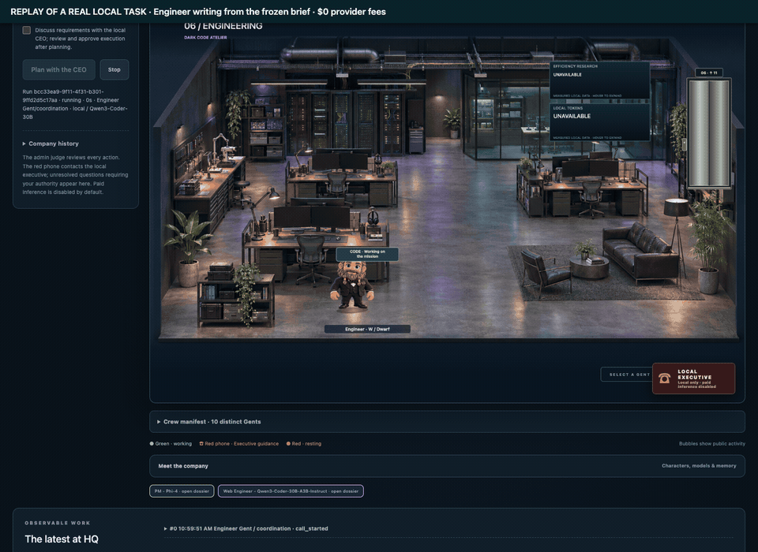

# Independent reasoning acceptance and a real local task

The guided CEO-to-factory path now freezes a separate local final-review contract into the owner-approved intake. Flow, hub delegation and peer collaboration still produce candidates first. A separately pinned local model reviews the final candidate against the original input and every frozen criterion. All criterion checks must pass before the terminal transaction can mark the job complete and create completed-task memory checkpoints.

This is a model judgment with host-enforced provenance and permission gates. It is not proof of arbitrary factual correctness, a security certification, or evidence that all three patterns can reliably solve arbitrary tasks. Native tool/file acceptance remains a separate path. Older reasoning intakes without this explicit review contract still stop at `candidate_submitted`; they do not gain authority retroactively.

The three patterns use the terminology in the publisher's public [chapter 4 preview of *AI Agents in Action, Second Edition*](https://www.manning.com/preview/ai-agents-in-action-second-edition/chapter-4). The independent review/lifecycle implementation is this project's design, not a claim of full-book access or endorsement.

## Boundaries

- `coordination/review/contract.rs` freezes the owner-listed local reviewer, distinct worker/reviewer weight identities, candidate-source ceiling and one-call budget. No tools, model downloads, historical memory search or vendor endpoints are available to this reviewer.
- `coordination/review/mod.rs` coordinates review through inference, access and journal ports. The review wire format remains separate in `completion_review.rs`.
- `coordination/journal/review_store.rs` revalidates the approved intake digest, canonical program, complete worker receipts/history, candidate lineage and current permission epoch. It records pending/received review checkpoints transactionally. A pending or rejected native call cannot automatically replay after restart.
- The terminal company transaction repeats the acceptance/source/epoch check before updating job state or completed memory. Rejection, uncertainty, malformed checks, source changes or revocation cannot become completion. A lifecycle checkpoint failure is shown as a storage error rather than leaving a misleading completed event.
- Model/usage events use normal correlated call spans, so native reasoning work and final review appear in observability. Presentation aliases map those host roles onto visible Gents; the reviewer has a separate visible position. These aliases never change native IDs, grants or memory access. Old recorded meetings no longer trigger a fresh conference animation on reload.

## Actual completed task

New run: `bcc33ea9-9f11-4f31-b301-9ffd2d5c17aa`. This continued the **earlier actual local CEO conversation and architecture assessment** in [the planning transcript](124-local-ceo-reasoning-conversation.md); it did not pretend to ask those questions again.

**Synthetic user:** I need a short update from a synthetic launch note, using one local writer and no tools, files, web or code. Ask me one question to confirm the desired output before planning.

**Actual local CEO:** What specific details or elements should the synthetic launch note include to meet your expectations for the update?

**Synthetic user:** Confirm the definition of done: return two concise sentences using only this synthetic note: the rehearsal is scheduled for Tuesday; the checklist remains under review. Do not invent facts. Use exactly one assigned local writer with no tools, files, web or code. The final answer must preserve both facts. Independent acceptance will be separate.

**Actual local worker:** The rehearsal is scheduled for Tuesday. The checklist remains under review.

The actual sequence was retained planning/architecture → read-only guided factory composition → frozen intake → exact digest approval → installed per-actor governance → native worker response → candidate checkpoint → distinct-weight local review → terminal source/policy gate → completed per-agent memory checkpoint.

| Observation | Verified result |
| --- | --- |
| Worker | Installed Qwen3-Coder-30B, pinned bytes |
| Independent reviewer | Installed Qwen3.8-27B, different pinned bytes |
| Runtime outcome | Completed; all four frozen criterion checks accepted |
| Independent fixture oracle | Exact normalized two-sentence answer matched; oracle frozen before execution and excluded from runtime packets |
| Model calls | 2 new native calls; earlier planning/architecture calls remain separately recorded |
| Local tokens | 1,418 input + 1,908 output = 3,326 |
| Wall time | 231,010 ms on this checkout/computer, including host admission/loading/verification; not a GPU forecast |
| Provider/tool fees | $0; hardware, electricity and frontier development excluded |
| Completed memory | One actor checkpoint bound to the approved digest and policy epoch |

The read-only Python verifier independently checked the canonical approval/program, exact worker/reviewer packets, native receipt identities, installed weight bytes, unchanged criteria, exact output and memory lifecycle. Local raw evidence is under `data/reasoning-completion-trials/<run>/`. A compact public record is [the evidence snapshot](evidence/reasoning-completion-2026-11-13.json).

The GIF is an **explicitly labeled visual replay** of the real task's retained event prefixes, with presentation motion and compressed timing. It is not a new live model run or a performance benchmark. The display clock follows recorded event timestamps. Historical room/assurance telemetry is unavailable in the replay, rather than replaced with current host totals or invented measurements. The original live browser recording is retained locally as well. Replaying does not call a model, start a task or install permissions.

## Failures retained, not relabeled as success

Three development attempts at a stricter sorted-ID JSON task did not qualify. The first 4B worker and the larger 30B worker returned an array where an object was required. Separate local judges rejected both. After clarifying the literal key/array requirement and specializing the fixture roles, the 4B worker produced over-escaped JSON; that trial also remained incomplete. The small judge's rejection explanation was itself unreliable in the last trial, reinforcing that review prose is not an objective oracle.

These were development cases, not a held-out benchmark or a fair paired improvement measurement. They remain in `data/reasoning-review-probes/77ff3a5a-6451-41de-a4da-5d95b2bd61ef`, `b755f455-111b-4de5-9267-5668786ec350` and `aa3d8ac6-1ec4-4f30-9d44-2dc6a8dec4da`. All are terminal/incomplete, with no inference replay or completed-task memory promotion. The native all-pattern JSON probe remains opt-in and **does not pass**. One completed writing task does not erase these failures or qualify hub/peer task capability. Robust structured output is still an open improvement.

## Security and release status

Fresh npm and root Cargo audits reported no known vulnerabilities in the checked dependencies. A separate Tauri audit found two TLS certificate advisories. `rustls-webpki` was patched to 0.103.16 and `webpki-roots` to 1.0.10; the desktop package passes `cargo check --locked` and its new audit reports zero vulnerability entries. Sources: [RUSTSEC-2026-0382](https://rustsec.org/advisories/RUSTSEC-2026-0382.html), [RUSTSEC-2026-0381](https://rustsec.org/advisories/RUSTSEC-2026-0381.html).

The Tauri lockfile still reports **glib 0.18.5 unsoundness** and **unmaintained proc-macro-error 1.0.4** warnings. These remain open desktop/Linux release-review items; the repository is not declared vulnerability-free or production-ready. The current pinned media lock also reports no known vulnerabilities. An audit result is a time-bounded advisory check, not a complete code/security review. The existing daily model-security service still requires provenance review; its `REVIEW_REQUIRED` status has not been waived.

The guided factory and independent acceptance implementation are available for a local owner trial. The whole-repository review, structured-output reliability, wider task/industry benchmarks, unresolved desktop dependency warnings, platform coverage, verified hardware-time comparisons and release/compliance review remain open. No source push, main promotion or new public deployment was performed for this change.

A new read-only GitHub dependency-advisory workflow covers **both** Rust lockfiles and the JavaScript lock, on push/PR, manual dispatch and a daily schedule. It pins the audit tool and fails on Rust warnings as well as vulnerability entries. The known Tauri warnings therefore remain a strict release gate; no ignore list was added. This workflow is configured locally and has not been published or run on GitHub in this change. Advisory coverage is separate from GitHub secret scanning, the local model scan and a complete source review.

Final verification for this change: 532 workspace Rust tests passed, 26 opt-in tests ignored; workspace build and Clippy with denied warnings passed; 32 focused JavaScript checks passed. Owner-bound HTTP admission/recovery checks and the guided-review browser check passed. The labeled replay additionally checks that the exact recorded engineer and independent reviewer occupy their expected visible positions. The three opt-in native JSON development attempts described above failed and are not hidden by the ordinary green suite.
