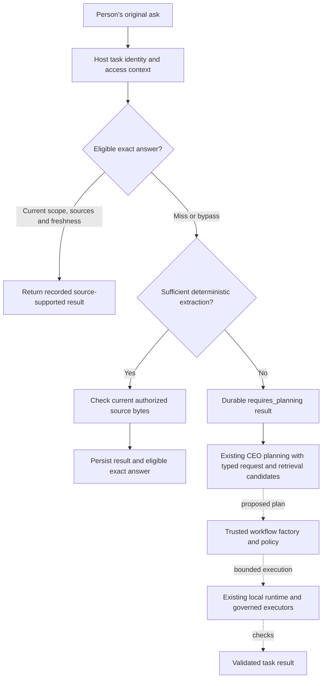

# CEO intake and cache-first task architecture

The active architecture refactor follows the owner's November 18 implementation brief. The CEO must preserve the actual person's objective, determine whether evidence/research or decomposition is needed, and propose a suitable registered execution path. Trusted host code validates policy, assembles the workflow, schedules resources and checks results. A sufficient cache hit, extraction or lookup exits before generative intake.

This is an implementation in progress, not completion of the brief. The first integrated stage adds shared Rust task contracts and an authenticated owner endpoint for exact source lookup, extraction, lexical retrieval and answer caching. Existing CEO planning, execution approvals, native MCP permissions, local providers and persistent company journals remain the integration targets. The office CEO entry now checks the shared cache/source path before requiring a model. Typed constraints and original request identity also pass into planning and its frozen intake; see [the integrated entry evidence](149-ceo-cache-first-intake.md).

## Architecture and implementation order



Solid edges describe the implemented CEO entry path. Dashed edges describe the remaining generalized workflow and scheduling integration. The standalone task API still returns requires_planning on a miss; the existing CEO endpoint performs its planning continuation. RAG will supply evidence to direct answers and larger workflows; it is independent of coordination. Final-answer caching remains separate from the existing provider prefix/KV cache and advisory semantic memory.

The sequence remains the full requested scope:

1. Inspect existing workspace/services and configured model inventory.
2. Versioned contracts, exact final-answer cache and deterministic source lookup.
3. Versioned ingestion/retrieval, grounded generation, CEO intake and evaluated model selection.
4. Evaluated semantic cache eligibility, compatible local embeddings and hard negatives.
5. Registered single-agent, assembly-line and hub-and-spoke executors.
6. Bounded hierarchy, scheduled peer collaboration, critique/revision and candidate exploration.
7. Hardware reservations, unified budgets/observability, specialist profiles and isolated optimization interfaces.

The router proposes; host policy authorizes. No new model stack, model download, cloud inference, weight edit or automatic source promotion is introduced by this stage. The existing non-Eve Rust implementation is retained.

## Current code and behavior

- `mcp/src/task_engine/contracts.rs`: versioned Serde task request, analysis, execution plan, policy and result types. Coordination, scheduling and strategy are separate dimensions. A host-generated UUID and exact original ask survive execution. Additional input fields such as tools or budget increases fail strict deserialization. Trusted policy is not deserializable from model output.
- `mcp/src/task_engine/repository.rs`: shared in-process SQLite services, called inside one host-owned transaction. New versioned tables use the existing company database. No competing database service or vector server is required.
- `crates/harness/src/task_frontdoor.rs`: owner-authenticated adapter to those services. All source and cache operations are private to the authenticated company owner. Agent access to this corpus through native MCP is not enabled yet; there is no implicit grant to workers.
- `POST /api/companies/{company}/tasks`: operations `execute`, `ingest`, `delete_source`, `search`, `status`, `inspect_cache`, `invalidate_cache`, `capabilities`.

An eligible `execute` does not call a model, classifier, planner, judge or reformatter. The first answer is a verbatim extraction from an owner-curated exact question binding or explicit UTF-8 byte selection. JSON output encodes that quote as a JSON string. No historical names/answers are embedded in production routing code. Curated question associations are supplied by the source owner; exact byte support does not independently prove the association's semantic entailment or the source's factual truth.

Requests with action intent, conversation context, extra constraints, proposed acceptance criteria or a separate deliverable bypass this limited extraction path. Incompatible language, stale/missing references and ambiguous multiple bindings do not produce an answer. Such results are persisted as `requires_planning`; no execution or missing fact is invented. The standalone task endpoint stops here. The existing CEO/UI endpoint continues to its governed planning path with the typed request and bounded local retrieval candidates.

The exact key preserves original bytes, output format/language, temporal scope, explicit input context and constraints, tenant/subject, current effective access, conversation identity, policy/profile/runtime compatibility and the current authorized source snapshot. TTL and evidence bounds participate too. A hit rechecks current authorized source coordinates and freshness. Dates, negation, units and entities are never stripped by text normalization. A true paraphrase currently misses; semantic equivalence is not simulated.

Ingestion validates source identity/revision, observation/expiry times and exact lookup coordinates. Changed source content or metadata requires a new revision. Lexical search filters tenant/subject and allowed source IDs before exposing text; results retain source revision, content digest and original byte offsets. It selects at most eight newline-delimited passages within an 8 KiB endpoint evidence budget. Overlong passages are omitted rather than silently truncated. This is lexical retrieval/extraction, not yet generated RAG or an embedding index.

Cache storage is bounded by the host policy (default 256 entries per tenant/subject, maximum 1024); stale entries are cleaned on execution, oldest entries are evicted, and explicit invalidation is available. Sources are bounded to 256 records of at most 64 KiB each. Task records retain the newest 1024 results per tenant/subject. Stored answer status is redacted after source/access invalidation. Measurements report zero actual generator/embedding calls and tokens for this path; unavailable memory stays null. Core elapsed time excludes HTTP transport and final database commit. No GPU, energy or dollar savings are inferred.

An immediate SQLite transaction serializes concurrent deterministic lookups so identical requests can reuse the first recorded extraction. Asynchronous model in-flight coalescence and independent subscriber cancellation remain outstanding.

## Discovery and retained boundaries

The existing offline `scripts/model_inventory.py` was reused on November 18. It found **17 weight artifacts**, **16 groups based on embedded identity claims**, and no parse failures in the local top-level model folders it inspects. It computes no full weight hashes unless explicitly requested. Conversions/quantizations can share a base; these figures do not establish 17 distinct base models, fifteen serveable generative workers, capability admission or loaded processes. Nested media packages, configured endpoint reachability, cloud proxies, aliases, full provider compatibility and runtime residency still need the expanded registry audit required by the brief. No models were loaded by the inventory or task endpoint checks.

The earlier bounded research agenda remains pending work from the former goal. Its real 4B researcher trial rejected the proposal before author dispatch, with twenty subsequent idle polls and no further API calls. It is not evidence for successful autonomous architecture selection, model training or the new CEO intake.

## Run and inspect

From the repository root, build and verify this stage:

```sh
cargo fmt --all -- --check
cargo clippy --workspace --all-targets --offline --locked -- -D warnings
cargo test --workspace --offline --locked
cargo build --workspace --offline --locked
python3 scripts/task_frontdoor_smoke.py
python3 scripts/model_inventory.py
```

The smoke script launches and stops its own private local harness, installs synthetic sources, exercises real HTTP/SQLite operations and uses no generative calls. Historical fixtures are confined to tests.

To inspect the endpoint with an existing registered local company, keep this terminal running:

```sh
AUTH_MODE=local GENTS_LOCAL_ONLY=1 CONFIG=config/company.local.json cargo run --offline --locked -p gents-harness
```

In another terminal, replace `<company>` with that registered company:

```sh
curl -sS http://127.0.0.1:8788/api/companies/<company>/tasks \
  -H 'Content-Type: application/json' -d '{"op":"capabilities"}'
curl -sS http://127.0.0.1:8788/api/companies/<company>/tasks \
  -H 'Content-Type: application/json' \
  -d '{"op":"execute","input":{"original_ask":"Describe the requested task"}}'
```

An unbound ask returns `requires_planning`. The existing CEO planning UI also uses the cache-first entry. Attachments, follow-ups and additional criteria continue into planning, with execution still requiring the existing approval flow. HTTP calls require the existing authenticated owner in nonlocal mode. Never submit credentials as source content or request text.

## Completion tracking against the full brief

| Brief section | Current evidence and remaining work |
| --- | --- |
| 1. Paths and quality/cost goal | Exact lookup/extraction/cache path implemented; grounded/direct/agent/workflow selection still required. No optimality claim. |
| 2. Technical premises | Existing shared serving retained; profiles are not weight copies. Production has no dependency on compression research. |
| 3. Repository/environment discovery | Workspace, MCP, CEO planning, persistence/providers inspected; artifact inventory refreshed. Full configured multi-host/provider/readiness inventory remains. |
| 4. Rust contracts/schemas | Shared initial Serde contracts implemented. CEO entry/SOW request custody and legacy transcript migration are integrated. Complete analysis fields, generated/checked schemas and generalized proposal validation remain. |
| 5. Cache-first ordering | New endpoint checks exact cache before any model. Main CEO/UI entry now shares that fast path. Subsequent generated-answer and generalized intake/route selection remain. |
| 6. Cache correctness | Scoped exact cache, source revisions, TTL/eviction, invalidation and regression cases implemented. Semantic cache calibration, embedding/routing caches and asynchronous coalescence remain. |
| 7. RAG | Owner-scoped ingestion, lexical retrieval and exact extraction implemented. Incremental chunk index, embeddings, source-quality/conflict sufficiency and one-generator grounded answers remain. |
| 8. Intake/routing | Existing durable CEO planning remains. Typed context/criteria enter its prompt, explicit criteria can bypass mandatory initial clarification, and retrieval candidates expose evidence gaps. Shared `destructure_task` and evaluated general routing remain. |
| 9. Factories/executors | Existing governed execution retained. Unified registry and distinct tested semantics for every requested pattern remain. |
| 10. Models/profiles | Existing local artifact/provider metadata reused. Exact unified registry, capability evaluations, specified specialist profiles and hundreds-of-profile residency tests remain. |
| 11. Scheduling | Existing local loader/hardware checks retained. Unified task resource reservations, global budgets and bounded fallback/cancellation need integration. |
| 12. Optimization track | Existing isolated training work retained. Unified disabled-by-default interface, immutable parent/candidate manifests and regression promotion gate remain. |
| 13. MCP/app/observability | Shared in-process core and authenticated HTTP adapter implemented. CEO UI/cache integration has real browser evidence. Native MCP task methods and unified traces/status/cancellation remain. |
| 14. Acceptance/evaluation | Focused deterministic tests and real HTTP fixture added. Complete frozen held-out set, semantic/RAG/workflow/oom/cancellation/profile and mixed-inventory evaluations remain. |
| 15. Delivery | First staged code/API/docs integrated. Full requested implementation, required checks, exact commands and evidence audit continue. |

Architecture references: [simple composable workflows](https://www.anthropic.com/research/building-effective-agents), [RAG paper](https://arxiv.org/abs/2005.11401), [current MCP specification](https://modelcontextprotocol.io/specification). Existing MCP transport/version compatibility is preserved in this stage; this is not a protocol upgrade claim.
