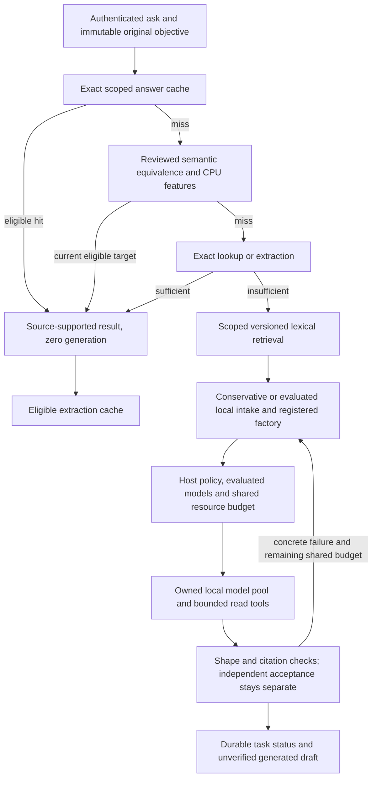

# Cache-first local task execution

This extends the existing Rust MCP task repository, authenticated owner task API, company SQLite journal and owned llama.cpp runtime pool. It adds no distributed service, model download or cloud inference dependency. The production company configuration is preserved; general generation requires explicit host `task_workflows` configuration and evaluated model/profile admissions.



## Code and contracts

- `mcp/src/task_engine/contracts.rs`: Serde task request, analysis, plan, trusted policy and result. Exact input/objective identity is checked. Policy is serializable for inspection and is **not deserializable from model JSON**. Caller hints have no endpoint, code, policy or budget fields.
- `mcp/src/task_engine/schemas.rs` and `config/schemas/task-engine-v1.json`: JSON schemas generated with pinned Schemars 1.2.3. Embedded tool inputs inline local references so nested schemas resolve correctly. Original version-one persisted task inputs/results remain readable; new SQLite structures use separate versioned tables.
- `mcp/src/task_engine/repository.rs`: scoped SQLite exact answers, source revisions, incremental paragraph/UTF-8 chunks, lexical retrieval and bounded retrieval cache. Chunk coordinates refer to original bytes; long lines split at safe UTF-8 boundaries. The same source snapshot reuses its index. Changed source content/metadata requires a new revision. Optional `dependencies` map repository-relative paths to SHA-256 values. The host rechecks bounded files through the existing confined workspace adapter before answers are reused and deletes invalid dependent source snapshots. In-process callers must supply the trusted workspace root through `refresh_dependencies`; native actors additionally need current file-read grants. Empty dependency maps retain the earlier source serialization for compatibility. Retrieval caches are capped at 128 entries per tenant/subject with at most 60 seconds of reuse; empty retrieval results expire after one second.
- `mcp/src/task_engine/semantic.rs`: reviewed paraphrase pairs, scoped CPU feature embeddings and strict semantic answer reuse. It reuses only an existing current validated extraction cache target. Unknown paraphrases miss even at high similarity. This provider is a 256-dimensional sparse word-feature projection, **not a learned embedding model**. Identity and dimension isolate embedding-cache compatibility; eviction caps the combined rows across all embedding identities. Owner review, exact complete paraphrase input, dates/negation/units/election guards, source snapshot, effective access, conversation, output and TTL all gate reuse. The threshold is an additional guard, never evidence of equivalence. It does not claim general semantic recall or a calibrated neural embedding threshold.
- `mcp/src/task_engine/routing.rs`: registered profiles, lightweight profile registry, conservative intake, factory and graph validation. Common explicit domain vocabulary supplies a profile hint; unknown difficulty remains unknown. A long prompt or many question marks do not create a team. Hints may propose a registered template and essential questions; they cannot authorize actions. Structured `TaskRequest`s call the in-process intake directly without text normalization.
- `mcp/src/task_engine/intake.rs`: quarantined model proposals, schema-constrained work shapes, bounded atomic dependencies and exact input/literal validation. Model analysis cannot replace original input, raise budgets, grant tools or choose an endpoint. Missing evidence is distinct from missing user intent. Clarification classification/questions must agree in both the native decoder schema and Rust validation.
- `mcp/src/task_engine/adaptive.rs`: optional evaluated intake plus concrete host-configured escalation. One call/token/tool/deadline budget covers intake, repairs, every worker and every plan revision. Evidence survives escalation. Cancellation, deadline, exhausted budget and changed source/access epochs cannot authorize another plan. Repeated template/model pairs and more than three replans are rejected.
- `mcp/src/task_engine/workflows.rs`: actual finite workflow graphs, typed stage replies, exact dependency messages, tool turns, bounded repair, output/context limits and source citation checks. Retrieved text never grants authority. Successful generation remains `generated`, with independent factual/build acceptance `not_run`.
- `mcp/src/task_engine/read_tools.rs`, `workspace_evidence.rs`, `project_metadata.rs`: host-bounded read registry, task-local file/listing captures and deterministic declared metadata. File/root/scope/TTL checks gate dispatch, delivery, status and compatible-job reuse. Captures do not alter the shared corpus; runtime build/query checks remain separate.
- `mcp/src/task_engine/resources.rs`: task-wide call/token/tool reservations, deadlines, cancellation and RAII concurrency/memory reservations. Explicit memory estimates include weights, adapters, KV, contexts, runtime and headroom. Measurements remain distinct from estimates. Idle profiles do not create model processes.
- `crates/harness/src/task_workflows.rs`: asynchronous owner adapter, shared existing runtime pool, immutable model pins, durable admission, duplicate-job coalescence, subscriber cancellation and restart handling. Interrupted/uncertain jobs are not automatically replayed. Terminal failures and missing-evidence results have one second of negative reuse; completed drafts keep their separate bounded history. Whole current source and scope snapshots are rechecked before results are delivered. Model selection requires host-admitted profile evaluations and feasible estimates; measured whole-path latency is preferred when supplied. Otherwise the configured default is preferred and no optimality claim is made.
- `mcp/src/functions/tasks.rs`: current-grant native MCP adapters. Each actor/run gets private knowledge and result scope. Ingest/invalidation require their own grants and approved job state. No worker can read the owner's private task corpus merely because it can search its own corpus.
- `mcp/src/task_engine/models.rs`, `scripts/task_model_discovery.py`: existing artifact/config/provider discovery. Endpoint probes do not load models and never establish inference locality merely from localhost. The Rust Ollama adapter supports bounded tags/show/ps metadata, capabilities and model-advertised thinking controls; it disables redirects. File/config inventory is exposed through the owner and native MCP interfaces. The CLI also inspects existing Ollama manifests, nested media packages and Hugging Face snapshots.
- `mcp/src/task_engine/optimization.rs`: disabled-by-default research manifest and explicit promotion-decision gate, independent of production answering. It records immutable parent/candidate digests, method, tools, licenses/data provenance, compatibility, compute/storage limits, held-out results and shared-model-plus-RAG baselines. Regressions reject eligibility. It does not implement quantization, distillation, pruning, adapter training or weight-space editing engines. Unconfigured methods are unavailable. No live weights or registry are mutated by a promotion decision.

## Registered execution semantics

| Template | Actual execution |
| --- | --- |
| `direct/v1` | One generator, when caller evidence requirements and host policy permit parametric output |
| `rag/v1` | Scoped retrieval followed by one grounded generator; no team |
| `tool_loop/v1` | One agent, bounded read-only search turns, then answer or insufficiency |
| `pipeline/v1` | Draft → transform → final |
| `hub/v1` | Scope → two complementary spokes → finalizer |
| `hierarchy/v1` | Manager → two delegates → manager review → finalizer; depth two |
| `peer/v1` | Two peers → two cross-reviews → designated finalizer; finite rounds |
| `critique/v1` | Draft → critique → revision |
| `explore/v1` | Two candidates → comparison → finalizer |

Logical parallel stages queue when host concurrency or memory is insufficient. All stages, failed attempts, repairs and tool turns share one global budget. Context overflow fails instead of silently dropping the objective or evidence. Native thinking and final-token allowances must fit the host's total generation reservation and actual installed backend support. Unsupported thinking controls are rejected by the existing runtime before generation. Host-configured escalation can respond to insufficient evidence, rejected output, unavailable providers, context pressure or capacity failure. It chooses a registered template and evaluated compatible model, reduces concurrency for capacity/provider failures, and retains the same remaining budget. Without an admitted feasible fallback it stops clearly. The existing native loader retains its GPU/reduced-offload/CPU recovery behavior. No automatic cloud fallback exists.

Profiles include intake, general, history, Angular, Cosmos, .NET/API, research, integration and evaluation. They are instructions/evidence/tool/validator requirements, not weight copies or proof of expertise. The answer executor registers read-only knowledge search plus optional confined workspace read/list tools. Workspace capture, static declaration parsing and source rechecks are documented in [`152-workspace-task-evidence.md`](152-workspace-task-evidence.md). Existing approved native workflows remain responsible for workspace writes, real Angular/.NET builds, Cosmos query execution and side-effect receipts. Such checks are not claimed passed by generated prose. Adding hundreds of profiles allocates metadata only; production admission still requires compatible evaluated model capabilities.

## Owner API

All operations use the existing authenticated route:

```text
POST /api/companies/<company>/tasks
```

Start an existing configured local harness in Terminal 1 and keep it running:

```sh
cd /Users/rmonzingo/repo-applications/gents-rust-lab
BIND=127.0.0.1:8788 AUTH_MODE=local GENTS_LOCAL_ONLY=1 CONFIG=config/company.local.json cargo run --offline --locked -p gents-harness
```

Use Terminal 2 for requests. Replace `<company>` with an existing company owned by the authenticated user. The command above binds port 8788; use the printed origin for other configurations.

```sh
curl -sS http://127.0.0.1:8788/api/companies/<company>/tasks \
  -H 'Content-Type: application/json' \
  -d '{"op":"capabilities"}'
curl -sS http://127.0.0.1:8788/api/companies/<company>/tasks \
  -H 'Content-Type: application/json' \
  -d '{"op":"destructure_task","input":{"original_ask":"Inspect the installed Angular and .NET API contracts"}}'
curl -sS http://127.0.0.1:8788/api/companies/<company>/tasks \
  -H 'Content-Type: application/json' \
  -d '{"op":"execute","input":{"original_ask":"Answer using the approved local references"}}'
```

`execute` always tries cache/extraction first. With `task_workflows` enabled, it uses conservative registered routing unless an evaluated optional intake model is configured; otherwise it retains the earlier grounded-answer/CEO handoff behavior. `execute_workflow` also accepts `hints` such as `{"template":"critique/v1","domain":"research"}`. That is a request for a host-validated template, not a permission grant. An answer miss returns either an async task ID or an explicit planning/disabled error. Actions stay in existing governed execution.

With `task_workflows.adaptive.intake` configured, `destructure_task` returns a subscriber task ID promptly. Poll `status`: `analyzed` includes the proposed `plan` and typed `analysis`, while `needs_clarification` contains essential intent questions. Analysis does not execute workers or side effects. `execute_structured` accepts a validated `request` (the complete generated `TaskRequest` shape), optional `hints` and `analysis_only`; it preserves the supplied task ID/input and skips model intake. Trusted policy, source checks, cache-first execution and registered plan validation still apply.

Each job freezes its original request and admission scope. SQLite `task_workflow_plan_revisions_v1` records actual plan IDs, revisions, previous-plan links, triggers and budget consumption; `audit` records intake receipts and dispatch/return events. A dispatch reservation alone is not proof of native inference. Coalesced subscribers retain their own status ID and point `cache.origin_task_id` to the original execution. The returned actual plan/analysis keep that original task ID rather than fabricating a second executed plan. Canceling one subscriber does not cancel the others. Completed plan revisions are cleaned up with expired/invalidated job records.

Other operation bodies:

```json
{"op":"search","query":"release contract","domain":"general"}
{"op":"status","task_id":"<returned-task-uuid>"}
{"op":"cancel_task","task_id":"<returned-task-uuid>"}
{"op":"inspect_cache"}
{"op":"invalidate_cache"}
{"op":"delete_source","source_id":"obsolete-source"}
{"op":"discover_models"}
```

`ingest` accepts `source` matching generated `KnowledgeSource`. Supply source ID/revision/title/domain/language, text, observation and validity times, and optional exact lookup bindings with source byte offsets. The host rejects stale intervals, unsafe content, ambiguous lookup results and changed content with a reused revision. Curated bindings are owner assertions about source support, not automatically verified factual truth. External ingestion/fetching is not performed by this read-only answer executor; network policy and configured ingestion adapters remain separate from inference locality.

`approve_equivalence` accepts a `rule` containing `canonical` and `paraphrase` TaskInputs, `reviewed_by` equal to the authenticated subject and `expires_at_ms` within one day. Only wording may differ; explicit task context, output, temporal scope and constraints remain equal. A source/authorization/model/profile/index change isolates or invalidates the target. Owner review cannot waive the implemented hard date/negation/unit/election guards. Unknown or uncertain equivalence misses.

Native MCP names are `destructure_task`, `list_capabilities`, `discover_models`, `execute_task`, `get_task_status`, `ingest_sources`, `search_knowledge`, `inspect_cache`, `cancel_task`, and `invalidate_cache`. Normal owner-installed per-actor grants and policy epochs apply. Native execution still returns eligible cache/source results synchronously. Explicitly configured company-bound workers now execute asynchronous analysis/generation through native status/cancel tools; see `155-native-asynchronous-tasks.md`. Transport protocol compatibility remains the existing negotiated `2025-11-25`; this is not a protocol upgrade.

## Configuration and extensions

The optional top-level harness `task_workflows` config matches `task_workflows::Settings`. Its `models` map contains existing `provider::Model` records, SHA-256 pins, explicit `MemoryEstimate`, evaluated profile IDs, evaluation references and optional measured whole-path latency. Configure `default_model`, task-wide `max_calls`, `total_generation_tokens`, `per_call_tokens`, `deadline_seconds`, bounded retries/pending jobs/concurrency, `resident_budget_bytes`, and whether parametric answers are allowed. Optional `workspace_reads` and `workspace_root` enable project reads under a company-private or explicitly shared project subdirectory; they do not expose the app root. Optional per-model `max_input_bytes` controls serialized input size while native token limits remain independent. Call tokens include any native reasoning reservation. Unknown metrics stay null. The isolated live-test script constructs an exact repository-specific configuration without changing the production config.

Optional adaptive configuration is explicit; production intake remains disabled until a model passes an independent qualification suite. Add this inside a complete trusted `task_workflows` configuration, using IDs already admitted in its `models` map:

```json
{
  "adaptive": {
    "intake": {"model":"evaluated-intake-id","tokens":1536,"max_repairs":1},
    "max_replans":2,
    "rules":[
      {"on":"evidence_insufficient","template":"tool_loop/v1","model":null},
      {"on":"invalid_output","template":"rag/v1","model":"evaluated-fallback-id"}
    ]
  }
}
```

The intake model must have host-admitted `intake` evaluation evidence. Its reasoning/final limits must fit its reservation. The same global `max_calls` and `total_generation_tokens` must fund intake plus any eventual worker graph; repairs do not receive a fresh allowance. The host can require evidence regardless of model output. Historical, research and technical profiles, temporal requirements, explicit source/citation/freshness criteria, and host-disabled parametric answering cannot be waived. Output-only style/format constraints do not alone require factual retrieval. Proposed assumptions remain separate from confirmed facts. Unavailable or unqualified workers produce a blocked result or a clearly unexecuted analysis proposal.

Add a model through the existing provider/runtime adapters and freeze its real digest and held-out admission before assigning profiles. Discovery is not admission. Add a profile to the registry with bounded instructions, evidence/memory scope, existing tools and concrete validators; the `AgentRegistry` accepts at most 4096 metadata profiles. Custom production profiles can be supplied through the trusted `task_workflows.profiles` registry configuration; they also require evaluated model admission. Add a workflow as a checked-in versioned finite template and meaningful semantics/dependency tests. Unknown templates, identities, graph edges and executable suggestions are rejected. Add a tool through the existing native registry, governance and typed read-tool adapter, not through model-generated code. Prefix/KV reuse remains a backend optimization separate from all final-answer caches; cross-task/session isolation retains the existing runtime behavior.

## Reproduce checks and inspect evidence

From the repository root:

```sh
cargo fmt --all -- --check
cargo clippy --workspace --all-targets --locked --offline -- -D warnings
cargo test --workspace --locked --offline
cargo build --workspace --locked --offline
cargo test -p gents-local-mcp --test adaptive_tasks --locked --offline -- --nocapture
python3 scripts/task_frontdoor_smoke.py
python3 scripts/task_workflows_smoke.py
python3 scripts/task_workflows_smoke.py --adaptive
python3 scripts/task_workflows_smoke.py --workspace
python3 scripts/task_workflows_smoke.py --workspace-denied
cargo test -p gents-local-mcp --test workspace_tasks --locked --offline
cargo test -p gents-local-mcp --test intake_replans --locked --offline
python3 -m unittest discover -s scripts -p 'test_task_model_discovery.py'
python3 scripts/task_model_discovery.py --probe
# Regenerate/check the versioned public contract bundle:
target/debug/gents-local-mcp --task-schemas > config/schemas/task-engine-v1.json
# Full repository checks (includes mock HTTP integration, no live inference):
bash scripts/check.sh
# Optional bounded real installed-model trial; writes only ignored trial evidence:
python3 scripts/task_engine_live.py
python3 scripts/task_workspace_live.py
# Frozen intake evaluation; existing Qwen3-4B, no downloads or worker execution:
python3 scripts/task_intake_live.py
# Reusing cases after prompt changes is calibration, not independent held-out proof:
python3 scripts/task_intake_live.py --evaluation-role calibration
```

`mcp/tests/fixtures/task-heldout-v1.json` freezes 36 representative cache/routing cases and hard negatives. The suite reports exact fixture accuracy/source support, false hits, generator calls and measured elapsed time. It makes no population-level factual-accuracy or optimality claim. Other tests cover all graph semantics, real tool turns, shared budget exhaustion, invalid schemas/models/tools, OOM, deadline/cancellation/context pressure, immutable objectives, mixed inventory, incremental reindexing, tenant/epoch/source invalidation and candidate regression rejection. `task_mcp` tests actual native grants/private scopes. `task_workflows_smoke.py` exercises real HTTP/SQLite with a marked mock provider; it proves transport/lifecycle behavior rather than model quality.

The November 18 inventory found 17 top-level weight artifacts in 16 embedded-identity groups, 24 total nested language/media artifacts, two Ollama manifests sharing one weight digest, and one Hugging Face cached snapshot. Ollama's daemon was unreachable; its existing blobs were present. The machine observation was Apple M4 Max, 36 GiB unified host RAM and 14 available logical threads. Unified GPU memory is not added to host RAM. All unprobed formats/hosts stay unknown; these numbers do not establish fifteen simultaneously serveable or evaluated workers.

Live trial evidence and archived isolated company checkpoints are under ignored `data/task-engine-live/<uuid>/`; discovery is under `data/model-registry/discovery.json`. The first small-model trials demonstrate why citation checking is separate from factual acceptance: 0.5B responses failed stage checks, and 1.5B/4B drafts confused the 1976 officeholder with the election winner. Those trials are excluded from production profile admission. A subsequent Qwen3-4B trial with a 512-token bounded-thinking reservation returned the independently expected exact name Gerald Ford in one call: 595 input tokens, 241 output tokens, approximately 8.25 seconds in the executor and 3,926,376,448 bytes observed process residency. This is one passing question, not broad profile admission. Exact source extraction and repeat-cache checks used zero generative calls. The live runner uses an exact independent expected-name check and records actual tokens/residency when the native runtime provides them. Trial results, including failures, must be reported separately from deterministic fixture success; neither a profile name nor one passing answer establishes broad expertise.

Production limitations are explicit: learned neural embeddings and broad semantic equivalence are not enabled; production small-model intake/routing quality is not established despite the implemented optional evaluated-intake path; specialist build/query validators require existing authorized native execution; the optimization track has manifest/evaluation gates rather than training/editing engines. No compression ratio, memory/energy savings, broad model quality or end-to-end autonomous implementation is inferred from this delivery.

Primary API/design references checked during implementation: [MCP specification](https://modelcontextprotocol.io/specification), [Ollama structured output](https://docs.ollama.com/capabilities/structured-outputs), [Ollama thinking metadata](https://docs.ollama.com/capabilities/thinking), [composable workflows](https://www.anthropic.com/research/building-effective-agents), [RAG](https://arxiv.org/abs/2005.11401), [prefix caching](https://docs.vllm.ai/en/latest/features/automatic_prefix_caching/), [semantic cache design](https://redis.io/docs/latest/develop/ai/redisvl/api/cache/), [structural pruning](https://arxiv.org/abs/2305.11627), [weight-space research](https://rikiyat.github.io/blog/weight-space-programming/), [WeightBench](https://arxiv.org/abs/2611.18553). These references do not establish production compression or preserved-capability guarantees.


## Full-brief completion ledger

The requirement-by-requirement audit is in [`151-task-engine-completion-audit.md`](151-task-engine-completion-audit.md).

The full goal remains active. This delivery implements the cache-first/retrieval-aware core and nine finite executors, not every requested adaptive production capability. The optional schema-constrained intake path, automatic work-shape factory selection and concrete shared-budget replan/escalation are now implemented with deterministic and HTTP/SQLite evidence. Production qualification is incomplete: the first independent 32-case Qwen3-4B intake trial passed all criteria on only 5/32 cases, with valid analysis on 25/32, expected domains on 23/32 and expected templates on 16/32. It used 50 native generative calls, median 11.28 seconds per task and up to 4,173,758,464 bytes observed process residency, with zero provider fees. It was not admitted. Schema/prompt corrections subsequently produced valid analysis on 32/32 reused calibration cases, with all criteria passing on 17/32 (31/32 domains, 20/32 templates, 29/32 evidence decisions and 31/32 clarification decisions). That rerun used 33 native calls, median 7.34 seconds and 4,145,758,208 bytes maximum observed residency. A bounded existing Qwen2.5-7B alternative passed 3/4 calibration cases, including the same missed short repository audit; it used four calls, median 3.95 seconds and 5,390,286,848 bytes observed residency. Neither is qualified for production intake. These reused cases are calibration, not new held-out proof. Reports and isolated checkpoints live under `data/task-intake-live/<uuid>/`.

Remaining required work includes production-quality independent intake/routing qualification; broader existing-provider/embedding adapter integration; broader approved native action tools and specialist-validator wiring, including real Angular/.NET/Cosmos integration checks (read-only project evidence and declared metadata are now implemented); broader routing/retrieval/model-quality acceptance evidence and specialist runtime outcomes. Native MCP async execution and task-UI lifecycle integration now have separate protocol/browser evidence. Current tools/errors and verification states disclose these limits. The research methods remain explicitly unavailable behind a disabled interface rather than pretending to train or compress weights.

The repository-check sequence exposed unrelated fixture/runtime issues while validating: four old smoke fixtures omitted the imported `public_research.py`, and `PinnedHTTPS` assigned its TLS context before the base initializer replaced it. Fixture copies were corrected, and the connector now passes the caller's context into the installed Python 3.15 `HTTPSConnection` constructor. The strict certificate/hostname defaults remain covered by the offline public-network tests. Checks were resumed in segments after these fixes; the original interrupted whole-script invocations are not claimed successful.

MLX task workers and pinned company adapters reuse the owned local runtime; see [`153-pinned-mlx-task-execution.md`](153-pinned-mlx-task-execution.md) for pin commands, offline tokenizer context checks, actual trial results and backend limitations. The existing CEO floor also exposes the owner task lifecycle; see [`154-local-task-workbench.md`](154-local-task-workbench.md) for browser commands and verification.
