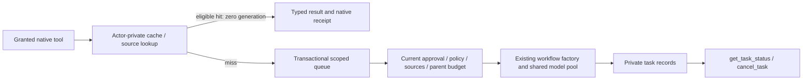

# Native MCP asynchronous tasks

Native task tools now hand off bounded inference to the existing harness workflow service through the same private company SQLite journal. They do not run a generator while holding an MCP tool transaction, impersonate the owner task API, create another model pool, or grant themselves tools. Both stdio and owned SSE use the existing protocol session and negotiated `2025-11-25` contract.



## Host setup and trusted scope

Inside a complete, independently admitted `task_workflows` configuration, explicitly enable the worker and name the companies it may serve:

```json
{"native_mcp":true,"native_companies":["<existing-company>"]}
```

This fragment supplements the existing pinned models, evaluated profiles, memory/call/token/deadline/concurrency limits documented in `150-adaptive-local-task-engine.md` and `153-pinned-mlx-task-execution.md`. Native execution is disabled by default. The company allowlist is mandatory; the worker does not publish availability into other company databases.

Keep the configured local harness running in Terminal 1. Start an MCP process in Terminal 2 using the trusted launching host's actual approved scope:

```sh
cd /Users/rmonzingo/repo-applications/gents-rust-lab
target/debug/gents-local-mcp --root "$PWD" \
  --company <existing-company> --owner local-developer \
  --run <approved-run-uuid> --actor <granted-actor> --phase worker
```

`local-developer` is the existing `AUTH_MODE=local` harness identity. Authenticated deployments must use the actual trusted owner identity. Tool JSON never supplies owner, actor, run, root, provider endpoint, policy or limits. Normal operator approval, current governance, optional source-epoch launch binding and per-tool grants still apply. `cancel_task` is a separately granted capability. Enabling a host worker does not install grants.

The parent run must be approved/active and its approved intake must contain a finite `max_model_calls` in 1–1024. Every intake, worker and repair reservation uses the existing `inference_attempt_reservations` ledger for that parent run, in addition to the shared per-task budget. Coalesced subscribers do not create duplicate calls. Failed preparation, crashes, new models or new child requests do not refund/renew the parent allowance. The task deadline includes queue time and is capped by an explicit parent `deadline_ms` when supplied.

## Native tool lifecycle

Use the normal MCP initialization and `tools/call` messages. For example:

```json
{"name":"execute_task","arguments":{"input":{"original_ask":"Answer from this actor's approved references"},"hints":{"template":"rag/v1","evidence_required":true}}}
{"name":"get_task_status","arguments":{"task_id":"<returned-task-uuid>"}}
{"name":"get_task_status","arguments":{"task_id":"<returned-task-uuid>","view":"summary"}}
{"name":"cancel_task","arguments":{"task_id":"<returned-task-uuid>"}}
```

The existing native receipt envelope is preserved: `structuredContent.value` contains the typed tool result and `structuredContent.receipt` contains the current native receipt. `execute_task` still returns `{intake,result}`. An eligible exact/source answer returns before any queue/model admission. A miss can return `result.status="running"` and `result.task_id`; initial verification is `queued_not_executed`. The worker then uses the same nine registered executors as the owner API, with durable plans, bounded repairs/replans, source checks and actual-or-unavailable measurements.

`destructure_task` remains deterministic when no model intake is configured. With configured evaluated intake and an available native worker it returns an analysis-only subscriber ID: status becomes `analyzed`, `needs_clarification` or an explicit failure. Analysis does not execute workers. `execute_task` also accepts `{request:<complete valid TaskRequest>,hints:{...}}` instead of `input`, retaining its task ID and skipping model intake. Mixing both shapes or adding policy/permission fields is rejected.

Each native actor/run has its own corpus and result subject. Owner-private or another actor's evidence is not substituted. A frozen custody record binds the original request, actor/phase/run, policy digest/revision, approval digest, source/access snapshot, host configuration and worker instance. Scope/source changes while queued, during execution or after completion invalidate delivery. Status also rechecks uncited corpus changes. Existing file dependency checks retain native file-read grants and descriptor-relative workspace boundaries.

Native model tool loops currently receive only `search_knowledge` when the actor has that grant. The owner's configured workspace/project root is never inherited. Existing native `files`/approved contract tools remain the way to read or act on workspace files under their own grants and exact native receipts. No task output can authorize writes, builds, queries or additional endpoints.

Identical compatible requests attach to one executor. Canceling one subscriber preserves the others. Queue claims are transactional and instance-bound. Worker restart/lost executor handles produce `interrupted` or invalidated results with uncertain usage where appropriate; they do not automatically replay inference. Policy/approval/deadline changes stop further dispatch and suppress stale output. A lease is an availability hint, not model serveability or quality evidence. An absent/expired worker leaves a deterministic miss as explicit planning needs.

The queue has finite per-company pending limits, 128 retained rows per actor/run subject and terminal pruning eligibility one hour after admission (cleaned lazily on enqueue). Active queue records survive ordinary task-history pruning. Corrupt packets are quarantined without executing them or blocking other valid packets. Company queue transactions are isolated so failure in one company cannot discard another committed claim. Cache inspection includes scoped native queue storage; task/job history is separate from verified answer-cache eligibility.

## Wire/schema bounds

Native task input/output schemas are derived from the versioned Rust contracts. Task tools advertise an `outputSchema` for the existing receipt/value wrapper, and the host validates typed results. `tools/list` pages fit within the preserved 64 KiB transport bound; opaque cursors bind to the current authorized catalog and reject changes. Clients follow `nextCursor` until absent. JSON-RPC string IDs are bounded to 200 bytes.

Before a task tool transaction commits, the host checks both the structured and serialized-text representations against the frame budget. An oversized admission rolls back; the original input is not truncated and no queue entry becomes visible to a worker. `view="summary"` omits evidence quotes, plan and analysis from status presentation while preserving answer, state, checks and measurements. Full source/current-access validation still runs before projection. Larger intake payloads can require a compatible transport rather than silently dropping intent.

This is the application's task lifecycle exposed through ordinary MCP tools. It does **not** advertise protocol-level task-augmented execution. Output-schema and structured-result behavior follows the [MCP 2025-11-25 tools specification](https://modelcontextprotocol.io/specification/2025-11-25/server/tools); MCP result schemas are distinct from model decoding constraints.

## Verification

```sh
cargo build --workspace --locked --offline
python3 scripts/task_native_smoke.py
python3 scripts/task_native_smoke.py --adaptive
python3 scripts/task_native_smoke.py --sse
python3 scripts/task_native_smoke.py --adaptive --sse
cargo test -p gents-local-mcp --test native_task_queue --locked --offline
cargo test -p gents-harness task_native --locked --offline
# Opt-in existing local Gemma generation through actual MCP stdio:
python3 scripts/task_mlx_live.py --native
```

The deterministic integration uses actual MCP stdio or private-token owned SSE, owner HTTP governance/approval and SQLite, with explicit mock workers. Both transports exercise every finite template, actor privacy, exact zero-call hits, duplicate coalescing/subscriber cancellation, revocation, restart without replay, parent budget exhaustion, configured-company isolation, analysis-only, essential clarification and structured bypass. The existing SSE origin/host/session/authentication checks remain in force. This is not model competence evidence. Unit tests cover custody/source changes, queue claims, corruption, independent company failures, retention, catalog/frame limits and admission rollback.

The separate existing-Gemma native trial uses a frozen synthetic literal/citation criterion, one local call, preflight/server token agreement and private company checkpoint. Provider fees are zero, no weights are downloaded or changed, and the trial is not production profile/intake qualification. Overall remaining specialist, quality and broader-provider requirements remain in `151-task-engine-completion-audit.md`.

The complete repository check passed with 662 Rust tests and 27 opt-in skips, strict Clippy/formatting, all four native protocol suites and the existing Python/Node/HTTP/web checks. Source/report fingerprints and retained failure evidence are in [`evidence/155-native-async-tasks-2026-11-19.json`](evidence/155-native-async-tasks-2026-11-19.json).

The current-binary native Gemma trial `937e42f2-a3d8-47d9-94db-a8b6ca312fc8` passed all ten protocol/literal/provenance checks: one generative call, 1,007 input tokens agreed by preflight and server, 58 output tokens, 38,914,557 microseconds task execution, and 13,923,762,176 bytes sampled process RSS. The parent ledger contains exactly one call reservation and one native admission, the result subject is actor/run-private, and the binary SHA remained unchanged during execution. RSS is not total Metal/unified-memory allocation. The earlier passing native trial `511733bc-c680-427f-98b1-4c09817f9d84` is retained separately. These synthetic trials do not admit a production model or establish expert quality.

Owner governance installation now acquires an immediate SQLite write transaction before reading the frozen intake. Native protocol regressions submit two simultaneous updates against the same expected revision and require exactly one save and one explicit stale-revision rejection, while queued work invalidates against the changed epoch. The initial full-suite attempt encountered an HTTP 400 at this boundary; its old fixture did not retain the response body, so that failure alone is not proof of a particular SQLite error code. The transaction change removes the deferred-read upgrade window, and the new diagnostic/regression checks retain the distinction.
