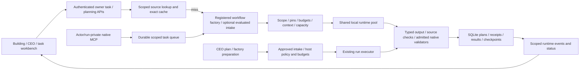

# Local execution baseline and bounded backlog

Inspection: November 21, 2026. Starting checkout: `codex/feature/public-research-view`, clean, origin `Monzingo89/gents-rust-lab`, HEAD `28a8da823231b792030eff5b6172dba29768442f`. No existing repository/ancestor `AGENTS.md` or `CLAUDE.md` was found. This slice adds the repository agent entry and skills; it does not replace existing runtime architecture or private configuration.

## Actual architecture



| Boundary | Current source and behavior | Limit |
| --- | --- | --- |
| Entry | `crates/harness/src/main.rs`: `/api/companies/{company}/tasks`, `/planning/{id}`, `/api/runs`; `task_frontdoor.rs`, `ceo_fastpath.rs`, `ceo_planning.rs` | These are distinct authority contracts. A CEO plan is not execution. |
| Workflow selection | `mcp/src/task_engine/routing.rs`, `intake.rs`, `adaptive.rs`, `workflows.rs`; harness `task_workflows.rs` | Nine finite templates; proposals require registered/evaluated profiles and host validation. Factory preparation remains in `company_factory/`. |
| Model/tool execution | `provider.rs`, `runtime_pool.rs`, `local_runtime.rs`; `mcp/src/functions/`, `protocol.rs`, `transports/` | Native stdio/SSE share catalog/governance. Legacy Python broker tools in `scripts/company_tools.py` remain separate. |
| Verification | Shared `validators.rs`, harness `acceptance.rs`, `completion_review.rs`, `verification_attempts.rs`; native Rust/Python/.NET/Angular tools | Output/citation membership is not factual acceptance. .NET/Angular execution needs frozen contracts/grants/runtime pins. Cosmos local query evaluator is separately implemented; see docs 157–161. Unsupported/unrun checks cannot become pass. |
| Persistence | `store.rs`, `company.rs`, `mcp/src/task_engine/repository.rs`, native queue and audit tables | Jobs, source lineage, plans, receipts, budget reservations and subscribers persist. Uncertain dispatches are not automatically replayed. |
| Context | `context.rs`, `worker_packet.rs`, `memory_handoff.rs`, `memory_archive.rs`; `mcp/src/functions/memory.rs` | Handoffs bind original record/source hashes, sender/recipient/run and policy revision; revalidate on read. Archive integrity is not recall quality or truth. |
| Authorization | `auth.rs`, shared `mcp/src/authority.rs`, `governance.rs`, workspace confinement and native custody | Owner-approved intake ceilings plus current actor/phase/tool/memory grants. Owner-private task corpus is not the native actor corpus. Same-user hostile OS processes remain outside the trusted-host boundary. |
| Building | `web/app.js`, `web/assets/task-workbench.js`, `office-activity.js`, `room-activity.js`, `tower-scene.js`, `office-dashboards.js`; harness `observability.rs`, `office_activity.rs` | Actual task/run events and sensor values coexist with a labeled staged tour. Sprites/accounting need no model. Optional efficiency researcher is separate opt-in inference. |

The workspace contains `gents-harness` and `gents-local-mcp`; Tauri is a separate excluded desktop package. Open WebUI was described by the owner, but no tracked Open WebUI integration/entrypoint was located in this inspection. Its deployment, model ownership and accounting boundary remain **unknown**; no new service is invented here.

The [monorepo architecture audit](174-monorepo-architecture.md) verifies the Git/editor boundary, tracked components, ignored task/dependency artifacts and separate desktop/frontend package boundaries. It repairs the container builder's missing workspace/embedded-source inputs while preserving Cargo membership. A full Linux image build remains unverified because the local Docker daemon is unavailable.

A later read-only host probe found Docker and Ollama CLIs, an inspected Docker context using a local Unix socket with no reachable daemon, and no reachable default Ollama endpoint at `127.0.0.1:11434`. No services were started. These observations do not identify another Open WebUI endpoint or establish that it is uninstalled; its ownership/accounting integration remains unknown.

## Loading, budgets and accounting

- `RuntimePool::new/configured` is a meaningful existing construction boundary. Default local execution is serial; `GENTS_LOCAL_SMALL_LANES=2` opts into two lanes only after host/process memory checks. Large models, training and auxiliary operations remain exclusive. The local backend owns process readiness, loading, session eviction and shutdown.
- Task settings admit pinned local/MLX models, finite call/token/deadline/context/concurrency/memory limits and evaluated profiles. Profiles do not load separate model copies. Measured routing latency may guide feasible selection; absent observations do not establish the fastest route.
- `inference_budget.rs` reserves calls transactionally against frozen approved intake. Failures, crashes and model switches do not refund allowance. Task/native budgets also bind to the parent run; CEO proposals cannot increase them. A reservation is not proof of actual inference.
- `provider::Usage` fields are optional. Runtime receipts can report tokens, latency, context and resident KiB; missing values are unknown. Provider fees exclude electricity/hardware and this development conversation. No paid runtime calls or cloud fallback are introduced.
- Office `totals` still cover completed legacy journal replies plus the local observer. The CFO screen now adds a separate owner-authenticated [retained company task receipt projection](167-retained-task-usage.md), deduplicated by job/call rather than subscriber result. Neither is a lifetime billing ledger. Unresolved/truncated/missing usage stays unknown; enforcement remains in deterministic runtime ledgers.

## Duplication and complexity audit

The shared task engine, native catalog/governance, runtime pool and factory modules already consolidate substantial behavior. Do not add another registry, scheduler, crate, model pool or generic plugin layer.

Concrete overlap: the older one-call `task_answers.rs`/`grounded.rs` and the newer `rag/v1` workflow both generate grounded drafts. They differ in eligibility, admission keys, subscriber records, model pins and recovery contracts. Retirement requires parity checks for status/cancel/restart/scope/TTL/typed input and configuration compatibility; visual similarity is not sufficient evidence to delete one.

The owner HTTP/native MCP adapters repeat some admission plumbing but have intentionally different subjects and grants. Existing smoke scripts repeat fixture setup; a wholesale fixture framework would obscure their independent authority checks. The new evaluation command composes them without rewriting their assertions. This slice consolidates the office summary/observer arithmetic in one `totals` function so unknown values are handled consistently.

The [concrete harness API simplification](175-concrete-harness-apis.md) removes eight single-implementation traits and the stateless trace wrapper after checking callers, registration, source-read allowlists and configuration. SQLite/file methods and projection bodies retain their contracts; runtime factories, interchangeable execution ports and public MCP interfaces remain in place.

## Representative commands and measurements

With dependencies already installed, from the repository root:

```sh
python3 scripts/local_evaluate.py
```

This builds current binaries offline, then runs launcher lifecycle checks, actual Rust control-plane readiness/shutdown, existing exact-cache/CEO HTTP, the older grounded executor, routing feasibility, all-template owner workflows, native stdio/SSE and building-screen checks in a fixed bounded sequence of eleven checks. It stops on failure, captures per-command elapsed time and log hashes, records the harness binary SHA and writes a new private `data/local-evaluation/<id>/report.json`. It kills only each check's owned process group on exit/timeout. No environment file is loaded by this command; mock fixtures do not establish model competence. Integration smokes create temporary company stores rather than changing the user's running company.

The frontdoor fixture reports eight concurrent cache requests (one extraction, seven hits), runtime source invalidation and tenant separation, actual elapsed time and one harness RSS sample. Its model calls/context/paid calls/provider fees are zero because it never dispatches inference. RSS is not peak residency, GPU allocation or real-model memory. Other unavailable measurements remain null. Fixture pass counts are not a verified real-task completion rate. Per-command latency includes setup/teardown; it is not token throughput. Compare like workloads and retain failed trials.

Additional existing checks:

```sh
cargo test --workspace --offline --locked
cargo clippy --workspace --all-targets --offline --locked -- -D warnings
node --test scripts/office-activity.test.mjs scripts/room-activity.test.mjs scripts/ceo-execution.test.mjs
python3 scripts/task_workflows_smoke.py --adaptive
python3 scripts/task_workflows_smoke.py --workspace-denied
python3 scripts/task_native_smoke.py --adaptive
python3 scripts/task_native_smoke.py --adaptive --sse
bash scripts/check.sh
```

`check.sh` is broader and includes platform-dependent checks; actual model and browser trials are separate opt-in commands. Existing real-model/task examples and their limits are recorded in docs 128, 140, 147, 150 and 155. They are historical evidence, not freshly rerun benchmarks.

## Portable skills and discovery

Five original skill bodies live only under `.agents/skills/`: `repo-simplify`, `harness-routing`, `context-governance`, `building-interactions`, `local-evaluate`. They use plain Agent Skills metadata, repository-relative paths and existing Rust/Node/Python commands. They do not add assistant-specific tool names, forced delegation or non-Rust execution conventions.

Claude project skill directories are symlinks to those canonical bodies, consistent with [Claude skill discovery](https://code.claude.com/docs/en/skills). Installed Kimi Code 0.9.0 scans `.agents/skills` natively; its installed bundle confirms that root (the [Kimi skill docs](https://www.kimi.com/code/docs/en/kimi-code-cli/customization/skills.html) describe the common format). CodeGPT 3.24.84's installed `standalone/core/skills/skill-catalog.ts` scans user-level CodeGPT/Claude roots, not repository roots. Five user-level CodeGPT links therefore point back to this checkout. No settings/toggles are overwritten; CodeGPT visibility is user-global, so the skill bodies require the matching current repository.

```sh
node scripts/repo-skills.mjs                 # check portable canonical/Claude layout
node scripts/repo-skills.mjs --codegpt       # also check this user's CodeGPT links
node scripts/repo-skills.mjs --install --codegpt  # recreate missing links, fail on conflicts
```

Installation checks all conflicts before writing links. Removing only these five links reverses the adapter; canonical skill files remain in the repo. Reload assistant sessions after discovery changes. Filesystem/catalog discovery and live model invocation are separate checks; no paid chat is needed for discovery.

Discovery was also exercised using CodeGPT's installed scanner source with its host/config imports supplied: all five entries were discovered and enabled under the existing settings. Kimi's installed root resolver, parser and discovery functions found all five from `.agents/skills` (filesystem, YAML loader and error class supplied). Claude's five project links resolve and metadata validation passes. Assistant UIs/live model invocation were not exercised. Extension source hashes and measured check results are in [the slice evidence](evidence/local-execution-baseline-2026-11-21.json).

Public candidates were reviewed **before** authoring; fixed revisions, hashes, license/attribution pointers and rejection/adaptation reasons are in [skill-sources.json](../.agents/skill-sources.json). No collection or public skill text/code was installed. Repository development skills remain distinct from the owner-approved runtime skill catalog under `docs/companies/`.

## Completed slice and next bounded work

Implemented: reusable fixture baseline; five canonical skills and compatible discovery; completed-reply accounting now preserves unknown tokens/cost/latency through totals, retained notebook coverage and UI/history. Empty no-call cost is zero; average latency without a reply is unavailable. Legacy notebooks with evicted receipts have unknown coverage rather than invented complete measurements. No evaluator, grant, model route, production config or paid-call policy was weakened.

Initial-slice verification: 697 workspace Rust tests passed, 33 opt-in tests ignored; strict offline Clippy, formatting, 16 focused Node tests, two evaluator failure/timeout tests and Vite production build passed. All six bounded suite commands passed in 128.93 seconds. The cache fixture measured 1,332.73 ms elapsed, 33,570,816 resident bytes (32.02 MiB; one sample), seven hits in eight concurrent requests, zero generative/paid calls and $0 provider fees. Real-model completion, peak/GPU memory, real-model context/routing quality and total hardware/electricity/development cost remain unknown. The broader `scripts/check.sh` and visual browser suite were not run for this slice.

Ordered backlog (one independently verified slice at a time):

The [requirement audit and routing correction](169-requirement-audit-and-routing.md) distinguish verified repository behavior from external/qualification gaps. Root-packet context feasibility now precedes latency ranking; configured latency values alone do not establish comparable native benchmarks.

1. Qualify broader accounting coverage. The CFO displays [deduplicated retained company task receipts](167-retained-task-usage.md), with legacy host journals separate. Lifetime accounting, external runtimes and retention rollups remain outside measured coverage. Optional efficiency research now [yields to job-scoped asynchronous work](168-background-research-priority.md); real-backend interruption latency remains unknown. Owner/native status share the [scoped task-event projection](164-scoped-task-progress.md).
2. Prove grounded-vs-RAG lifecycle parity, then retire only duplicate implementation with compatibility coverage. Their shared model-pin admission now lives in an independent module, with warm-cache permission regression coverage; see [the model-pin slice](165-shared-model-pins.md).
3. Extend structured handoff/recovery cases to more executor entrypoints. [Native pending-dispatch revocation now settles a redacted terminal checkpoint](166-revoked-task-settlement.md), with no revival after regrant on stdio/SSE. Typed memory bindings also revalidate after a real database reopen. [One actual native cancellation/recovery case](171-native-cancellation-recovery.md) now measures a 210 ms cancellation/reap and fresh-session reply. Combined owner-HTTP/native latency, general crash/source-I/O reconciliation and wider handoff coverage remain open.
4. Extend frozen real-model representative tasks and held-out routing evidence. [One real GGUF reference trial](165-shared-model-pins.md) passed its fixed oracle. [The initial Rust trials](170-native-rust-qualification.md) failed. [Focused follow-ups](172-focused-rust-task-evidence.md) now retain a failed 4B candidate and one independently accepted 27B candidate under the unchanged task/suite. Across these four Rust trials, 1 passed; no production route was promoted. Broader competence, routing optimality and peak/GPU memory remain unknown; no download or paid fallback.
5. Verify the actual Open WebUI boundary and model ownership, then bound its accounting/concurrency integration if present.
6. Extend lifecycle fault coverage to additional mobile/activity entrypoints only after contract parity is established. Company supervisor/wrapper readiness, cancellation, restart and owned descendant cleanup have dedicated checks; see [163](163-company-lifecycle.md). [The two real-model probes now share instance-bound startup and process-group cleanup](173-owned-probe-lifecycle.md), with an occupied-port regression and no-inference Rust checks. The fixed baseline now has eleven commands.
7. Verify a full Linux container build and its supported startup configuration when a Docker daemon is available. The [monorepo audit](174-monorepo-architecture.md) repaired missing build-stage workspace/embedded-source inputs and passed a staged macOS release compiler check; this is not container runtime or deployment evidence.
8. Continue simplification only across demonstrated shared behavior. The [concrete harness API slice](175-concrete-harness-apis.md) removed unused interface layers; SDK receipt/frame duplication and the larger grounded-vs-RAG overlap still need independent contract-parity coverage before consolidation. Keep source-read paths, runtime factories and owner/native authority boundaries intact.

## Startup and shutdown today

`npm run env:check` audits settings without exposing secrets. `npm run company` invokes `scripts/start-company.mjs` → `run-company.sh` → offline workspace build → `run-harness.mjs` → pinned runtime bundle. It runs the existing doctor, opens `http://127.0.0.1:8788`, and may start configured optional integrations. Keep that terminal running. Ctrl+C requests supervisor/harness shutdown. Do not start it merely to run fixture checks or disturb an existing service on 8787/8788. `/health` is process liveness. The supervisor now checks local-only control-plane settings, the requested native transport, a verified sealed bundle and its own startup instance ID; it does not claim model/tool/task readiness. [Lifecycle behavior and evidence](163-company-lifecycle.md) cover the next slice. No live production company restart/shutdown was performed.
